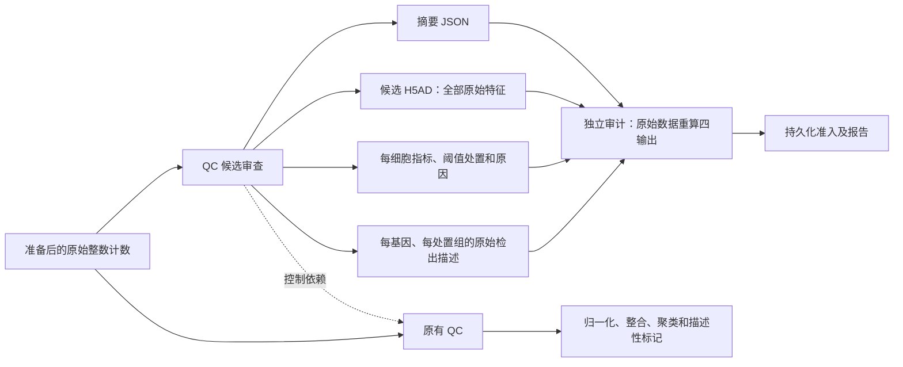

# P2：保留 QC 候选及公开数据复现实验

本轮增加 `qc_review / raw_count_qc_review_v1`：将被原有 QC 阈值排除的细胞保存为独立候选分支，原始计数、完整基因轴及排除原因可逐项核查。候选不返回主分析，不生成科学 claim，也不自动解释为受损细胞。默认 3 scaled MAD 及冻结的 2/4 scaled MAD 敏感性策略保持原有规则。

## 架构与返回证据

- 审查继承实际 QC 任务的输入和两个阈值；不允许独立覆盖阈值。每个多目标研究只产生一个共享审查。
- 四项产物：`qc_review` 摘要、`qc_candidates` 原计数候选、`qc_review_cells` 全细胞处置表、`qc_review_features` 全基因 × 四处置组表。候选 `X` 与 `layers.counts` 均保存原计数，保留完整特征顺序，不带派生 embedding 或 raw 槽。
- 优先使用原 `layers.counts`，否则使用整数 `X`。线粒体来源与原 QC 一致：`obs.percent_mito`、布尔 `var.mt`、基因符号前缀。没有指标时保持缺失，空组的均值与比例保持缺失。
- 独立审计从原始输入重算，不调用 producer 的计算 helper。它检查全部四项产物、原 SHA、身份和顺序、计数精度、阈值、完整特征覆盖、结构性缺失、禁止恢复及禁止损伤诊断等声明。即使直接调用 ScientificAuditor 且省略 required audits，也必须执行专用审计。
- 没有被排除细胞时，空候选集合法；全部被排除时，原有 QC 仍停止主分析，但已准入的候选证据保留。通用空矩阵和缺失值规则只对该方法的指定产物作窄例外，专用审计必须独立核对。
- 报告只读取具有唯一、匹配任务结果的持久化准入记录。四项输出都经过 `get_audited_many` 后，才显示候选数、处置表、实际文件及完整 SHA。高检出基因描述不等于细胞类型判定、差异表达或存活证据。
- 审查显式返回空 evidence 列表，避免通用提取器为不存在的科学证据额外读取四输出。候选产物不成为主统计输入。

## 数据来源与先后边界

所有原始下载、派生数据、缓存、临时目录、日志、原生输出及外部评分存储在 `F:/EACBP-architecture-p2`；PBMC 原始输入沿用 F 盘既有文件。源码和本文件位于当前仓库。

1. **PBMC3k 回归**：2,700 个原始细胞、32,738 个特征，沿用 P1 输入和冻结科学标准。processed reference 覆盖 2,638 个原始细胞，另外 62 个保持无参考标签。重复数据属于工程回归与相关敏感性分析。
2. **Baron 2016 人胰腺新数据**：从 [GSE84133](https://www.ncbi.nlm.nih.gov/geo/query/acc.cgi?acc=GSE84133) 下载 GSM2230757–GSM2230760 四个人类来源 count CSV。合并为 8,569 × 20,125，整数计数总和 49,942,062。每个源 CSV 的每个计数 token、行和特征轴都通过独立核查。原文见 [Baron et al.](https://pmc.ncbi.nlm.nih.gov/articles/PMC5228327/)。本实验仅用人类部分，并非论文全部人/鼠细胞。

Baron 准备输入移除作者 `assigned_cluster`，仅保留原细胞身份、barcode 及来源 donor 标识。作者标签保存为独立外部 reference。协议在第一次原生运行前冻结：总体及每个作者类别保留率至少 80%、ARI 至少 0.5、NMI 至少 0.6，以及七对既定胰腺标记的外部 CP10K 描述一致性。这些是本轮预设复现门槛，并非原文声称的精确数值目标。

每个数据集先完成默认和两个冻结 QC 分支的原生分析。外部评分器逐个验证全部任务的 snapshot、持久化 audit/commit 和实际 payload；三分支都通过后才打开 reference。评分前后核验原生结果、输入、协议及标签 SHA，评分不回写配置或 completion。

Baron 的 prepared input SHA-256：`af6de40e11d46cd1cf00dd33c2d5a9b33a46e7476aa5f87fdd0d35fcd3b16116`；冻结协议 SHA-256：`56d54585e308866223a8c937fd6f39cb453f2c2f21656e7c428d93a059ef16e3`。完整四源文件 SHA 见 F 盘 `verification/baron-download-source.json`。

## 本轮验证

六次原生运行均为 `status=success`、`analysis_request_status=complete`；两份 `qc_sensitivity/comparison.json` 均为 `completed`。每份 runner 收据证明输入前后 SHA 一致，安装分布及 EACBP 源码环境前后一致。PBMC 三分支共用时约 156 秒，Baron 约 412 秒；运行期间同时有 CI，因此不是隔离性能基准。

| 验证范围 | 通过数 | 跳过 | 显式移交其他 lane 的 deselect |
| --- | ---: | ---: | ---: |
| core | 866 | 0 | 1 |
| standard | 154 | 0 | 1 |
| advanced-statistics | 71 | 0 | 0 |

各 lane 的 manifest、JUnit、日志、执行命令及源环境均由 F 盘收据保留。新增 producer 27 项、独立 auditor 56 项、真实流程集成 8 项已进入 core；覆盖有效重新注册后的篡改、非法原输入、大整数精度、所有线粒体来源、空/全候选、恢复执行、未准入报告以及开启/关闭审查的主产物一致性。

集成时发现并修复一个真实对接问题：执行器会加入 `execution_attempts`，最初的严格科学摘要比较拒绝这个合法执行字段。现在仅接受正整数且不超过契约重试上限；全部科学字段仍精确核查。首轮失败日志继续保留。另两个测试 harness 问题（原 X 输入没有 counts layer、续跑未传 resume）已修正，原记录未覆盖。

## 外部评分结果

六次候选工程验收全部通过：候选与主 QC 留存细胞唯一、互斥并覆盖全部原细胞；每条候选计数与完整特征轴可从原数据精确重建；四种处置组的全基因描述独立重算一致；候选没有进入主推断。科学验收六次均未完全通过，保持 `failed`。

| 数据 / 冻结 QC | 主分析留存 | 候选 | 外部 ARI | 外部 NMI | 未通过的科学检查 |
| --- | ---: | ---: | ---: | ---: | --- |
| PBMC / 默认 3MAD | 2,562 | 138 | 0.5318 | 0.7260 | 每个参考类别保留率 |
| PBMC / 较严 2MAD | 2,450 | 250 | 0.5793 | 0.7551 | 总体及每类保留率 |
| PBMC / 较宽 4MAD | 2,637 | 63 | 0.5160 | 0.7165 | 每个参考类别保留率 |
| Baron / 默认 3MAD | 8,569 | 0 | 0.4091 | 0.7155 | ARI 低于 0.5 |
| Baron / 较严 2MAD | 8,150 | 419 | 0.4363 | 0.7384 | 每类保留率及 ARI |
| Baron / 较宽 4MAD | 8,569 | 0 | 0.4091 | 0.7155 | ARI 低于 0.5 |

PBMC 默认巨核细胞仅保留 5/15，较严 4/15、较宽 11/15，仍均低于冻结的 80% 每类保留门槛。候选现在可复查，但保存并没有自动改善主结果。P2 与 P1-v3 的三个 PBMC 分支中，QC、归一化、整合、聚类及描述性 marker 共 **15 对科学产物全部精确一致**：obs/var、X、layers、PCA 等 slots 和 marker 数值均一致，矩阵最大差值 0；没有依靠容差通过。比较前后旧 38 项、新 60 项记录及 artifact 字节 SHA 不变。

Baron 较严分支继承 `min_genes=953`、`max_mito_pct=100`，419 个候选全部是 `low_gene_count`，完整保留 20,125 个特征。其作者标注 mast 保留 15/25、t_cell 保留 4/7，低于 80%。默认 `min_genes=685`、较宽 `min_genes=492` 均未排除原有 deposited cells；这些零候选原生运行也通过独立审计。较宽分支与默认掩码相同，不是新的独立验证。

三种 Baron QC 的 GCG/INS/SST/PPY/GHRL/PRSS1/KRT19 七对预设 marker 在外部作者类别的 CP10K 均值描述中全部一致。但原生无监督聚类的参考 ARI 仍不达门槛：七个 marker 的一致性不能替代群体结构复现，更不能用外部标签调节 resolution 后宣布通过。

图中分母是 reference-source 类别细胞数，红色为低于预设 80% 每类门槛。图及对应 PDF/SVG 仅用于外部描述；不会把作者标签当作独立存活或损伤真值。

## 限制与后续工作

- 保存候选解决可追溯性与复核问题，本轮没有自动救回细胞。作者标签源于表达数据，没有独立损伤、存活或身份实验；不能据此判定候选应恢复。
- deposited counts 已经过原作者捕获及处理，不能恢复此前已丢弃的原始 droplets。
- 四输出的独立核查和报告仍会重复加载大 H5AD。显式空 evidence extractor 只去掉一次无用读取；尚未完成流式审计或证明超大数据的内存安全。
- 首轮 RSS 采样只捕到 Windows venv 启动器，未覆盖真正的分析解释器。原收据保留，并附独立 `resource-measurement-correction.json`；约 4 MiB 采样不可作为分析内存峰值。本轮不声称性能改善或完整峰值测量。
- 通用 donor 角色声明输入通道需要原数据 SHA、准备声明、任务契约、审计及 resume 的完整来源闭环。本轮不将任意 `uns` 声明视为已验证来源；相关架构提案留待独立实现和 Kang 原输入重放。
- 新实验提示下一步应把聚类分辨率、特征选择和批次处理的输入依据与稳定性证据显式返回。可先冻结不读取标签的多分辨率方案，以共同细胞一致性、各 donor 覆盖及采样扰动稳定性评估，再单独评分外部参考；不能依据这次 ARI 或稀有类别标签反向挑选参数。
- 导出与搬运必须保存整个原生目录及 `qc_sensitivity`。现有 primary export 未打包相邻分支注册表。

## 结果入口

- [本轮完整索引](F:/EACBP-architecture-p2/verification/p2-acceptance.json)。
- [PBMC 默认报告](F:/EACBP-architecture-p2/runs/pbmc3k-p2-v1/report.md)。
- [Baron 默认报告](F:/EACBP-architecture-p2/runs/baron-human-p2-v1/report.md)。
- [PBMC 外部评分](F:/EACBP-architecture-p2/verification/pbmc-qc-candidate-external-science-v1.json)、[Baron 外部评分](F:/EACBP-architecture-p2/verification/baron-qc-candidate-external-science-v1.json)、[主科学产物回归](F:/EACBP-architecture-p2/verification/pbmc-primary-science-regression-v1.json)。
- 两套外部评分、源核查、协议冻结、失败日志、CI 收据均在 F 盘 `verification`。
- [P1 历史实验文档](C:/Users/hahaj/Desktop/EACBP/docs/ARCHITECTURE_P1_EXPERIMENTS.md)及原 acceptance 不覆盖。历史完整性核查覆盖明确列出的 14 个经典记录、P1 最终索引及其文档共 16 项，不宣称重新核验了所有旧 payload。
